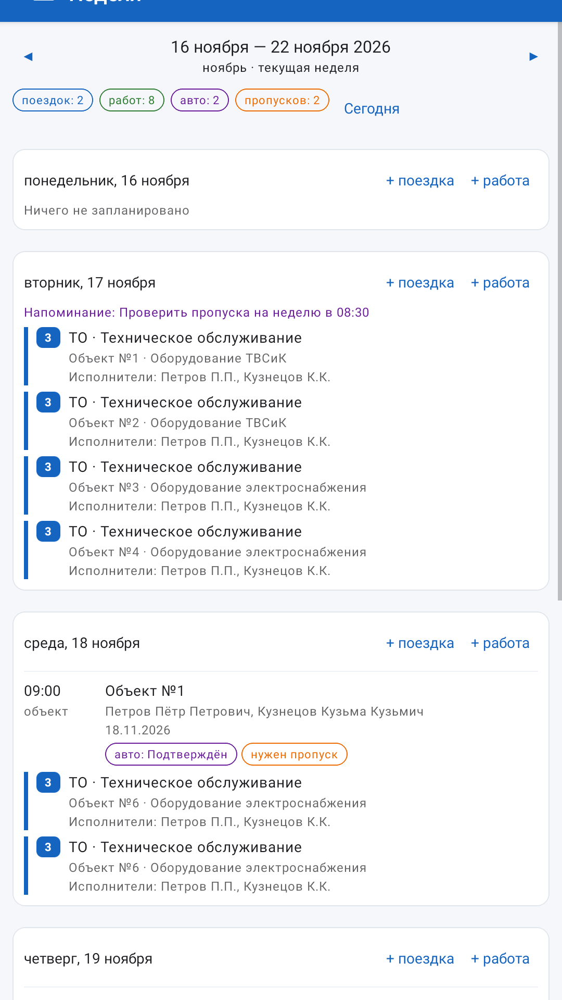
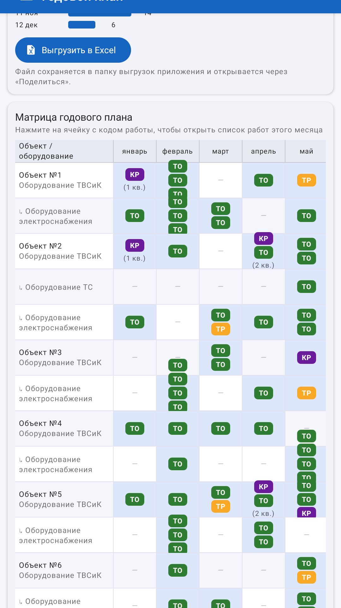
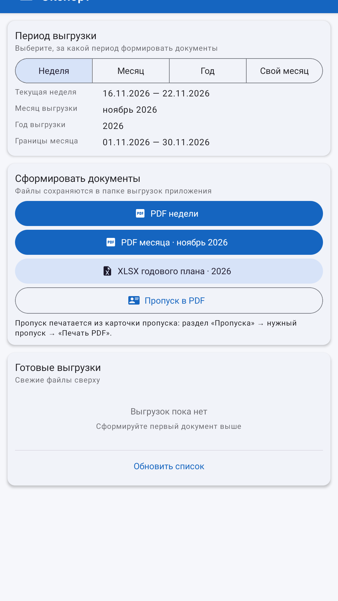

# Планировщик работ бригады

Офлайн-приложение для мастера бригады службы энерговодоснабжения: годовой график
технического обслуживания и планово-предупредительных ремонтов, недельные поездки
бригады, пропуска, фотофиксация и отчётные документы.

**Работает без интернета.** В релизной сборке заблокировано разрешение `INTERNET`
и `ACCESS_NETWORK_STATE` — не «не использует сеть», а физически не имеет к ней
доступа. Серверной части, аккаунтов, синхронизации, рекламы и аналитики нет.
Все данные остаются на устройстве.

Это **описание проекта, архитектуры и принятых решений**. Исходный код, ключи
подписи и релизные сборки не публикуются — см. раздел «Что не опубликовано».

---

## 1. Задача

Мастер участка ведёт план работ по объектам и оборудованию, ставит поездки бригаде,
оформляет пропуска и отчитывается перед руководством. Обычно это делается
в Excel и на бумаге: план живёт в одном файле, поездки — в другом, пропуска —
в третьем, а факт выполнения фиксируется фотографиями в галерее телефона.

Приложение собирает это в одно место и, что важнее, **работает там, где связи нет** —
на промплощадке, в котельной, в поле.

## 2. Что умеет

**Планирование**

- Годовой план работ: матрица «объект × оборудование × 12 месяцев» с кодами работ
  (О, Т, К, ТО, ТР, КР, Д, Пн, В, И).
- Месячный и недельный план: работы по неделям и дням, работы без даты, фильтры
  по объекту, статусу и приоритету, отметка выполнения.
- Перенос работ — **только вручную**: с причиной, комментарием и новой датой,
  с журналом переносов. Автоматического переноса нет намеренно: решение принимает
  мастер, приложение лишь предлагает варианты.

**Люди и выезды**

- Поездки: объекты, состав бригады, автомобиль, пропуск и работы на выезде.
  Многодневные командировки с командировочным удостоверением.
- Исполнители: назначение сотрудников на конкретную работу, роли и квалификация.
- Отсутствия: отпуск, больничный, медосмотр, отгул, командировка — видны
  при планировании, чтобы не поставить работу на отсутствующего.

**Документы**

- Пропуска: номер, срок действия, объект, печать бланка.
- Фотофиксация выполнения работ: снимок с камеры или из галереи.
- Экспорт и импорт XLSX, формирование отчётов в PDF.
- Резервное копирование базы.

**Напоминания**

Локальные уведомления о заказе автомобиля, оформлении пропуска, сроках работ
и командировочного удостоверения.

## 3. Архитектура

| Слой | Решение |
|---|---|
| Платформа | Android, `minSdk 26`, `targetSdk 36` |
| Каркас | Expo SDK 54, React Native 0.81 |
| Язык | TypeScript в строгом режиме |
| Интерфейс | React Native Paper (Material Design 3), react-navigation |
| Хранилище | SQLite (`expo-sqlite`), 10 миграций схемы |
| Уведомления | `expo-notifications`, только локальные |
| Отчёты | XLSX и PDF, формирование на устройстве |

Данные — только локальная база. Никаких сетевых вызовов в коде нет: это не
соглашение, а ограничение, зафиксированное в манифесте приложения.

## 4. Инженерные решения

**Офлайн как требование, а не как компромисс.** В `app.json` заблокированы
`INTERNET`, `ACCESS_NETWORK_STATE` и `WRITE_EXTERNAL_STORAGE`. Приложение
не может выйти в сеть даже при желании — это проверяемо и на этапе модерации,
и пользователем.

**SQL проверяется в Node, без эмулятора.** Интерфейс доступа к базе описан так,
что ему удовлетворяют и `expo-sqlite` на телефоне, и адаптер `node:sqlite`.
Репозитории принимают базу первым аргументом и не используют глобальных
синглтонов — благодаря этому весь SQL, миграции и CRUD прогоняются обычным
Node-скриптом за секунды, без сборки Android. Это ускорило разработку сильнее
любого другого решения.

**Миграции только вперёд.** Применённые миграции не редактируются: изменения
вносятся новой версией. Схема доведена до версии 10.

**Проверка вместо надежды.** В проекте 13 скриптов автоматической проверки:
миграции и сид, CRUD репозиториев, импорт XLSX, отчёты, поездки, отсутствия,
состав бригады, напоминания, очистка данных. Перед завершением любой задачи
`npm run verify` должен быть зелёным.

**Данные из реального производства.** Справочники сгенерированы из исходных
XLSX: 27 объектов, 39 позиций оборудования, 22 типовые работы, годовой план
на 2026 год. Файл с данными генерируется, а не правится руками.

## 5. Масштаб

| Показатель | Значение |
|---|---|
| Экранов | 30 |
| Файлов в исходниках | 85 |
| Строк TypeScript / TSX | ~19 600 |
| Репозиториев доступа к данным | 15 |
| Сервисов (отчёты, экспорт, фото, уведомления) | 10 |
| Миграций схемы | 10 |
| Скриптов проверки | 13 |
| Зависимостей | 23 |

## 6. Что не опубликовано и почему

Проект — самостоятельная разработка. В открытом доступе его **нет**:

| Не публикуется | Причина |
|---|---|
| Исходный код приложения | Продуктовая разработка |
| Ключ подписи релиза (`*.jks`) | Компрометация ключа позволила бы выпускать обновления от имени разработчика |
| Релизные сборки APK | Готовый продукт |
| Справочники из производственных данных | Содержат сведения о реальных объектах и оборудовании |

Публичный репозиторий содержит только описание, архитектуру и результаты —
этого достаточно, чтобы оценить уровень работы, но не чтобы её воспроизвести.

## 7. Права

Все права защищены. Условия использования — в файле [COPYRIGHT.md](COPYRIGHT.md).
Копирование, распространение, переработка и коммерческое использование материалов
без письменного разрешения автора не допускаются.

---

**Автор:** Александр Ковтуненко · [github.com/WiMean](https://github.com/WiMean)
